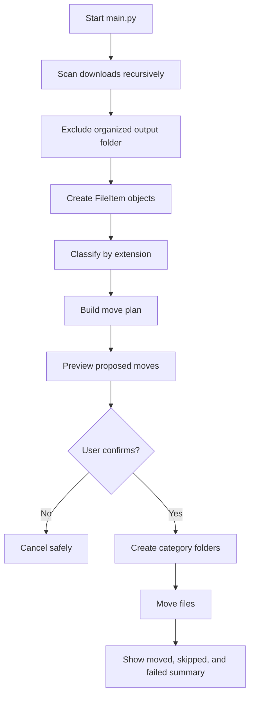

# Smart File Organizer

A small Python command-line tool that organizes files in a directory by file
type. It scans a folder, creates a move plan, shows the proposed changes, and
only moves files after the user confirms.

> **Project status:** Initial phase / proof of concept  
> The current version is intentionally simple and focuses on a safe,
> understandable organization workflow.

## Features

- Recursively scans a directory for files.
- Classifies files using their extensions.
- Groups files into category folders.
- Shows a preview before making changes.
- Creates destination folders automatically.
- Avoids overwriting an existing destination file.
- Renames duplicate destinations using names such as `report_1.pdf`.
- Tracks successful moves in memory.
- Supports undoing the most recent successful move through the Python API.

## How it works



## Default categories

| Extensions | Category |
| --- | --- |
| `.pdf`, `.docx`, `.txt` | `Documents` |
| `.png`, `.jpg`, `.jpeg` | `Images` |
| `.py`, `.java` | `Code` |
| Any other extension | `Others` |

The rules are defined in [`Rule_engine.py`](./Rule_engine.py), so additional
extensions can be added without changing the scanner or mover.

## Example

Given this input:

```text
downloads/
├── report.pdf
├── photo.jpg
├── script.py
└── notes.xyz
```

The organizer proposes:

```text
downloads/
└── organized/
    ├── Documents/
    │   └── report.pdf
    ├── Images/
    │   └── photo.jpg
    ├── Code/
    │   └── script.py
    └── Others/
        └── notes.xyz
```

The `organized` directory is excluded from future scans to prevent the tool
from repeatedly processing files it has already organized.

## Requirements

- Python 3.10 or newer
- [`uv`](https://docs.astral.sh/uv/) (recommended) or a standard Python
  installation

The code uses modern type-hint syntax such as `str | Path` and
`list[FileItem]`, so Python 3.10+ is required.

## Getting started

Clone the repository and open its directory:

```powershell
git clone <your-repository-url>
cd "Smart file organizer"
```

Create a test directory named `downloads` in the project root, or update the
directory passed to `Organizer` in [`main.py`](./main.py).

Run the organizer:

```powershell
uv run python main.py
```

By default, the application scans `Downloads` and writes categorized files to
`Downloads\organized`.

To choose a different source and destination, pass them as positional
arguments:

```powershell
uv run python main.py "C:\FilesToOrganize" "C:\OrganizedFiles"
```

The first path is scanned recursively. The second path receives category
folders such as `Documents`, `Images`, and `Code`. Both paths may be relative
or absolute; absolute paths are recommended when the source and destination
are outside the project directory.

The same options can be written as named command-line arguments:

```powershell
# Preview without moving anything
uv run python main.py --source Downloads --dry-run

# Organize after the interactive confirmation
uv run python main.py --source Downloads

# Choose a different destination
uv run python main.py `
    --source "C:\FilesToOrganize" `
    --output "C:\OrganizedFiles"
```

The named options and the older positional form are equivalent. Do not mix
the two forms in one command. `--dry-run` always stops after the plan preview,
before confirmation and execution.

The program displays a proposed move for every discovered file:

```text
Proposed file moves:
Move downloads\report.pdf to downloads\organized\Documents\report.pdf
Do you want to execute the plan? (y/n):
```

Enter `y` to perform the moves, or any other response to cancel.

The source and destination can also be provided through Python:

```python
from organizer import Organizer

organizer = Organizer(
    root_directory=r"C:\FilesToOrganize",
    output_directory=r"C:\OrganizedFiles",
)
operations = organizer.build_plan()
organizer.preview_plan(operations)
```

If no destination is supplied, the existing default is preserved:

```python
Organizer("Downloads")
# destination: Downloads\organized
```

### Running without uv

If Python is installed directly, run:

```powershell
python main.py
```

## Running tests

Run the test suite through Python so the project root is included in the
import path:

```powershell
uv run python -m pytest
```

To run one test file:

```powershell
uv run python -m pytest test/test_rule_engine.py
```

## Project structure

```text
.
├── main.py                 # CLI entry point
├── organizer.py            # Coordinates the complete workflow
├── FIle_scanner.py         # Recursively discovers files
├── File_item.py            # File metadata wrapper
├── Rule_engine.py          # Maps extensions to categories
├── move_planner.py         # Builds proposed source/destination moves
├── file_mover.py           # Executes moves and reports results
├── undo_manager.py         # Undoes the most recent successful move
├── schemas/
│   └── MoveResult.py       # Result model for move operations
├── test/                   # Automated tests
└── Downloads/              # Local sample data; not required by the code
```

## Safety behavior

The tool does not move files immediately after scanning. It first builds and
prints a plan, then asks for confirmation. It also:

- skips a destination when a file already exists there;
- reports failed moves instead of hiding errors;
- leaves the input files untouched when the user declines;
- excludes the output directory from subsequent scans.

The current undo history is held in memory and is lost when the program exits.
For that reason, the undo functionality is currently intended for use from
the Python API, not as a persistent command in the CLI.

## Current limitations

- The input directory is currently hard-coded as `downloads` in `main.py`.
- Category rules are extension-based and case-insensitive, but not content-aware.
- There is no persistent operation history.
- There is no dry-run command-line flag; preview is always shown before
  confirmation.
- Configuration, logging, and command-line arguments are not yet exposed.

## Roadmap

- Add command-line arguments for source and output directories.
- Add a configuration file for custom category rules.
- Add persistent move history and a CLI undo command.
- Add a `--dry-run` option and machine-readable output.
- Improve duplicate handling and expose conflict policies.
- Add broader test coverage for scanning, planning, collisions, and undo.
- Package the application so it can be installed and run as a command.

## Contributing

1. Create a feature branch.
2. Make a focused change.
3. Add or update tests for the behavior.
4. Run `uv run python -m pytest`.
5. Open a pull request describing the change and its safety impact.

## License

No license has been selected for this initial phase. Add a license before
redistributing the project publicly.
